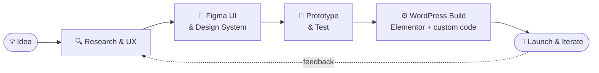

<!-- ============ HEADER ============ -->
<p align="center">
  
</p>

<p align="center">
  <a href="https://gglias.github.io">
    
  </a>
</p>

<p align="center">
  <a href="https://gglias.github.io"></a>
  <a href="https://smartupweb.com"></a>
  
</p>

---

### 👋 About me

I'm a **product designer** who doesn't stop at the mockup. I design interfaces in **Figma** and then build them for real in **WordPress** — themes, Elementor layouts and custom plugins — so what the client approves is exactly what goes live.

```js
const greg = {
  role:        "Product Designer",
  designsIn:   ["Figma", "FigJam", "Adobe CC"],
  buildsWith:  ["WordPress", "Elementor", "PHP", "JavaScript", "CSS"],
  alsoDoes:    ["Design systems", "Prototyping", "Motion (Blender)", "Multilingual sites (WPML)"],
  currently:   "Shipping Smart* plugins & client sites @ Smartup",
  motto:       "If it isn't usable, it isn't designed.",
};
```

---

### 🎨 → 💻 How I work



---

### 💼 At Smartup

I work at **[Smartup](https://smartupweb.com)**, where I've designed and built a family of small, focused WordPress plugins — designed first, coded second:

| Plugin | What it does |
| :-- | :-- |
| 📣 **[SmartBanner](https://github.com/gglias/smartbanner)** | Floating banner that promotes a blog post or custom content, multilingual with WPML |
| 📝 **[SmartInquiry](https://github.com/gglias/smartinquiry)** | Step-by-step quote form in a popup, with a PDF brief generated on the server |
| 🍪 **[SmartConsent](https://github.com/gglias/smartconsent)** | Cookie consent with Google Consent Mode v2 and a self-building cookie policy |
| 📅 **[Simple Booking](https://github.com/gglias/simple-booking)** | Online appointments for a salon *(beta)* |

---

### 🧰 Toolbox

**Design**

<p>
  
  &nbsp;
  
  
</p>

**Build**

<p>
  
  &nbsp;
  
  
</p>

**Ship**

<p>
  
</p>

---

### 📊 GitHub stats

<p align="center">
  
  
</p>

<p align="center">
  
</p>

<p align="center">
  
</p>

<!-- Snake eating the contribution grid — generated by .github/workflows/snake.yml -->
<p align="center">
  <picture>
    <source media="(prefers-color-scheme: dark)" srcset="https://raw.githubusercontent.com/gglias/gglias/output/github-snake-dark.svg" />
    <source media="(prefers-color-scheme: light)" srcset="https://raw.githubusercontent.com/gglias/gglias/output/github-snake.svg" />
    
  </picture>
</p>

---

<!-- ============ FOOTER ============ -->
<p align="center">
  
</p>
